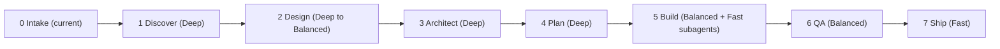

# maestro — agent skills that conduct your projects

> An **agent skill** (SKILL.md format), not the Maestro mobile-testing tool.

`maestro-web` guides an AI coding agent through a whole web project, from idea to live URL. You bring the idea; it runs the phases, picks the right skills, and tells you **when to switch models and reset context** so you don't burn premium tokens on trivial work, or use a weak model on decisions that matter.

- **Captures the idea** and sizes the work (`tweak`, `small`, `project`).
- **Maps your models to tiers** (Deep / Balanced / Fast), across 13 vendors including Chinese labs (DeepSeek, Qwen, Kimi, GLM, MiniMax, Doubao-Seed) and local models.
- **Finds and chains skills** per phase (superpowers, grill-me, taste-skill, ui-ux-pro-max, and more) and installs them **only with your approval**.
- **Tells you exactly when to switch** with the command for your agent, and saves state so a fresh chat resumes in ~30 lines.

## Install

```bash
npx skills add Fauzi41/maestro --skill maestro-web
```

Add `-g` to install globally. Manual install: copy `skills/maestro-web/` into your agent's skills folder (for example `~/.claude/skills/` for Claude Code, or your agent's documented skills directory).

Then say **`maestro`** or "build me a website for …".

## Supported agents

Claude Code · Antigravity · Cursor · Codex · Gemini CLI · GitHub Copilot · Windsurf · OpenCode · Cline / Roo Code / Kilo Code · Trae · Qwen Code · Kimi CLI. Others work with generic switch instructions.

## Flow



Size decides which phases run: `tweak` = build → qa; `small` = light discover, design, light plan, build, qa, ship; `project` = all. With superpowers installed, design and architect fold into the brainstorming spec, so there are no duplicate gates.

## Commands

| Command | What it does |
|---|---|
| `maestro` | Start a project (intake) |
| `maestro resume` | Continue from `.maestro/state.md` in a fresh chat |
| `maestro status` | Phase, artifacts, next step, recommended tier |
| `maestro skip <phase>` | Skip a phase with a reason |
| `maestro models` | Update which models you have |
| `maestro budget <thrift\|balanced\|quality>` | Change how often Deep models are used |

## What a switch looks like

```
⇄ SWITCH → Balanced (balanced)
Phase: plan → build · why: plan done, implementation is routine
Claude Code: /model sonnet
Context: state saved → /clear, then "maestro resume"
```

maestro switches only at phase boundaries (or after 2 failed attempts), skips the switch when the next phase is short, and delegates small tasks to cheap subagents when your agent supports it.

## Repository layout

```
skills/maestro-web/
  SKILL.md                  # router (always loaded when triggered)
  references/               # loaded only when needed
    models.md, models-catalog.md, skills-catalog.md, token-rules.md
    phases/intake|discover|design|architect|plan|build|qa|ship.md
  templates/state.md
tools/check.mjs             # structural checks: node tools/check.mjs
```

## Contributing

Model names change monthly. To update, edit `skills/maestro-web/references/models-catalog.md`, bump `Last verified:`, and run `node tools/check.mjs`. Rows marked `(unverified)` especially need confirmation from official vendor docs.

## Roadmap

`maestro-desktop` · `maestro-design` · `maestro-video`

## License

MIT
